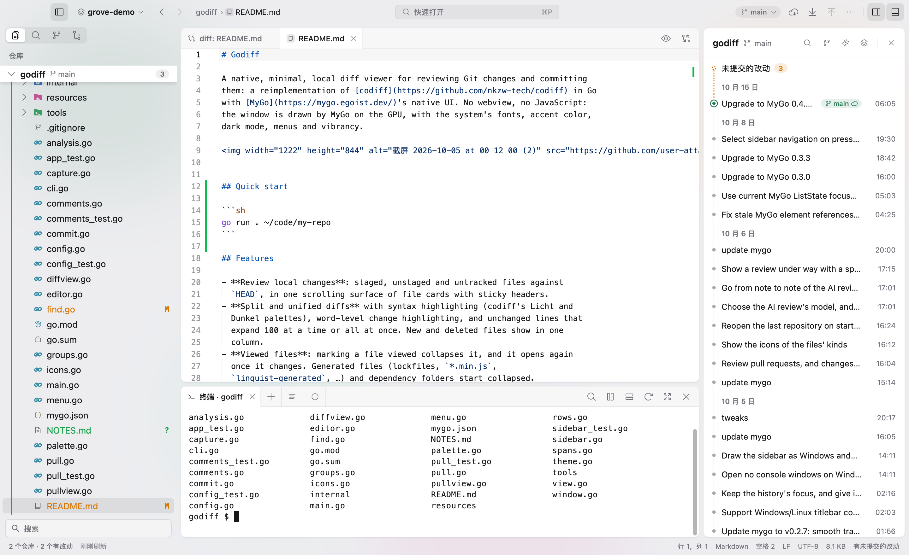
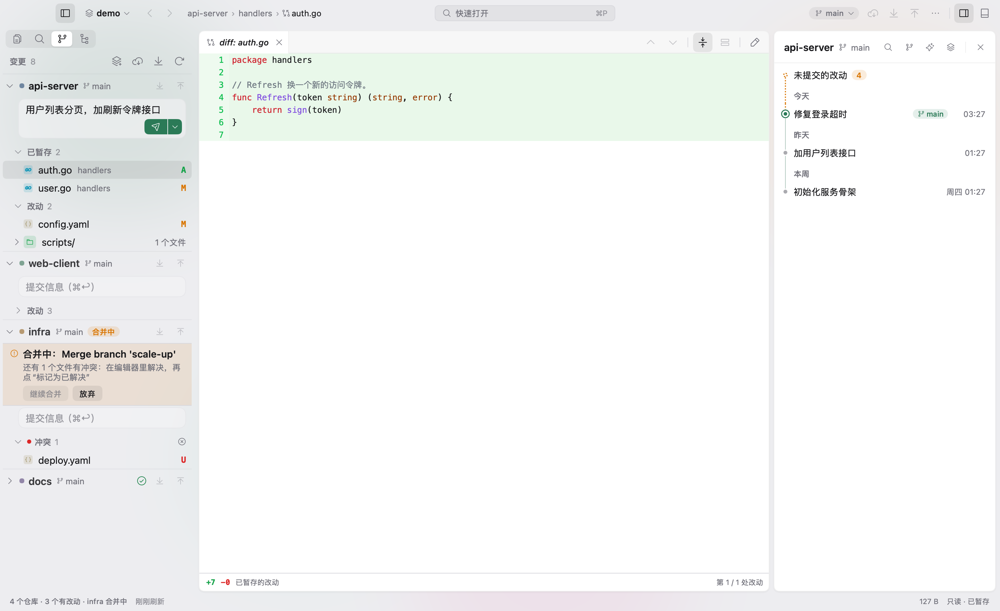
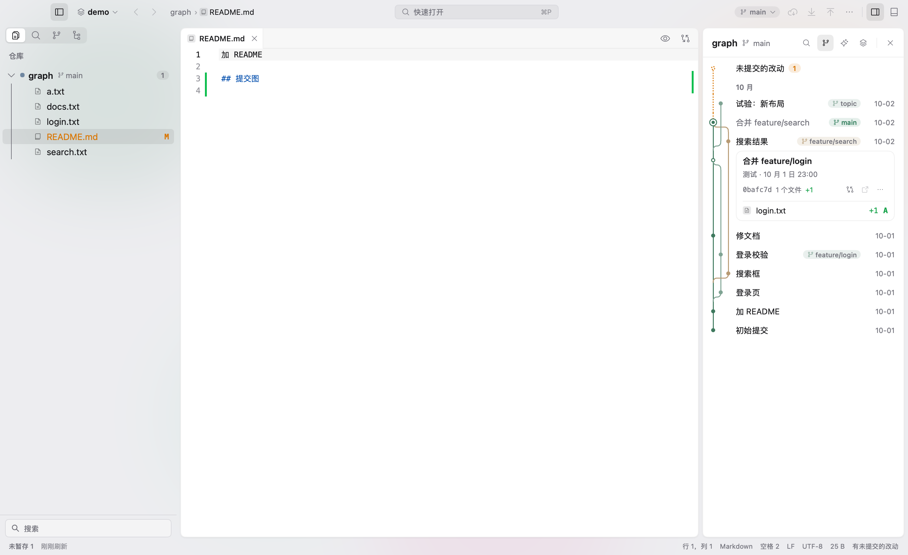
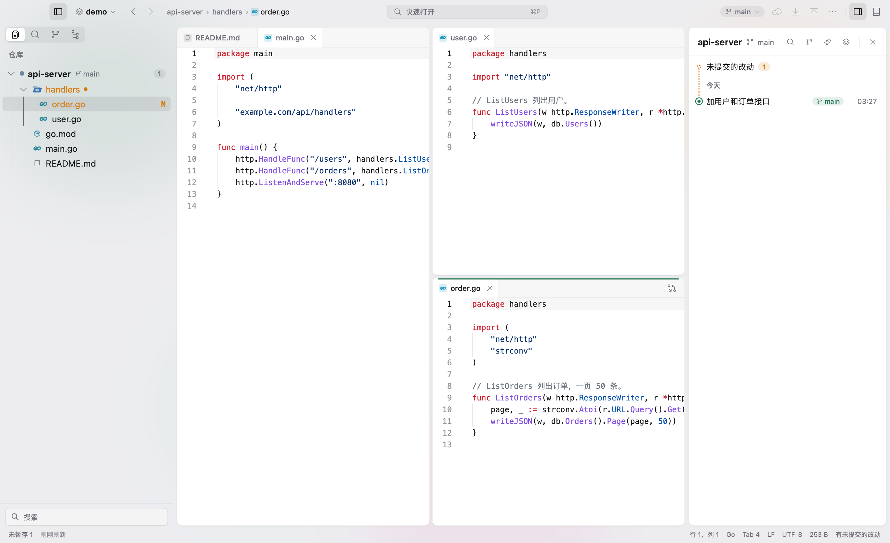
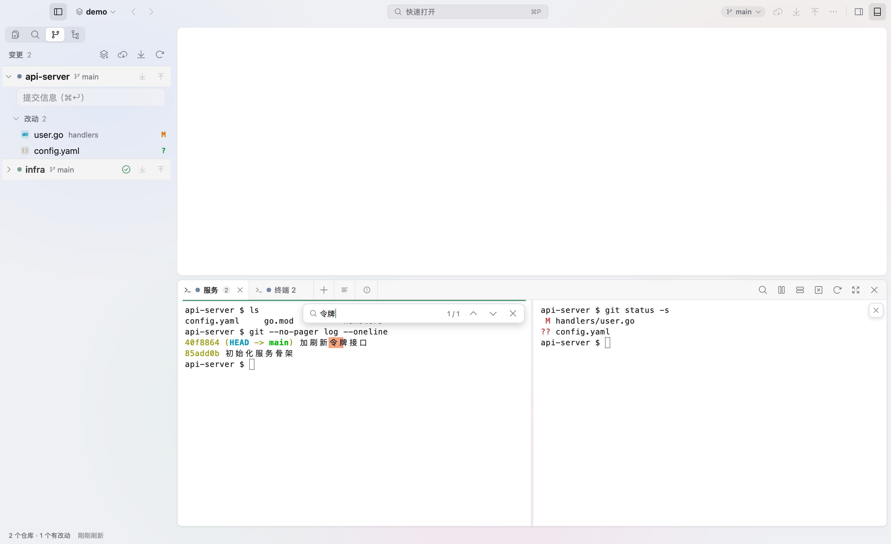

# Grove

[中文](README.md) · English

Grove is a multi-repo workbench for macOS. Browse files, edit code, review Git changes and commit history, and use
terminals in one window. The file tree and Git bar show every repo in your workspace, so you can review their
changes together.

Grove is written in Go, with a native UI drawn by [mygo](https://github.com/egoist/mygo). With five repos open, it uses
about 79 MiB of memory when idle.



## Three principles

- **Every repo visible at once**: the file tree and Git bar show all repos. Search, history and terminals are also
  organized by repo.
- **You decide when to make changes**: automatic refreshes only run read-only Git commands, with
  `GIT_OPTIONAL_LOCKS=0` to leave the index unchanged. Staging, committing, pushing and other write operations require
  your input. Operations that could cause data loss ask for confirmation first.
- **No automatic uploads**: Grove only connects to remote repos when you start a Git operation such as fetch, pull,
  push or clone.

## Features

| | |
| --- | --- |
|  |  |
|  |  |

- **Workspace**: open a `.code-workspace` file or a folder, with support for multiple windows. Select and drag files
  across repos in the file tree, and undo the last file operation.
- **Editor**: drag a tab to an edge to split the editor. Includes an outline, sticky scroll, snippets and Markdown
  previews with Mermaid and math. Supports encodings such as GB18030 and Big5. Run formatters like gofmt and prettier,
  or checks like go vet and eslint, on save.
- **Git**: stage changes by hunk or line and resolve conflicts in the editor. View a commit graph for one repo, or the
  history of all repos merged by time; commits co-authored by a coding agent are marked and can be filtered. Merge, rebase (including interactive rebase), cherry-pick, stash, worktree and submodule operations
  are available in the UI. Each repo's header in the Git panel has its own Pull and Push buttons, with ahead / behind
  commit counts; in each repo the commit box sits at the top, untracked files share the "Unstaged" group with unstaged
  changes, and worktrees and stashes start collapsed. Each worktree is an agent's desk: one row with a single status mark (waiting for you, running, ready to
  merge, has changes, idle, merged); expand it to see what it adds over the main branch, review it, or merge it into main.
  A collapsed worktree group shows the most urgent mark on its header.
  A "Needs you" bar at the top lists worktrees across all repositories that are waiting or ready to merge, with previous /
  next buttons to jump between them. Git actions that are greyed out say why ("Push (in sync with origin)"), and button tooltips show the
  git command they run.
  Hovering (or selecting with the keyboard) a changed file shows inline Open File, Discard Changes and Stage / Unstage
  buttons; with the list focused, Space stages / unstages and ⌘⌫ discards, acting on all selected rows.
- **Terminals**: each repo has its own set of terminals, built on Ghostty's libghostty-vt, with split panes. Layout
  and output are saved when you close the window. When an agent such as claude or codex runs in a terminal, its tab
  shows whether it is waiting for you (an amber dot: it rang the bell or sent a notification; gone once you switch in)
  or running (a spinner); more agent commands can be added in Settings.
- **Search and navigation**: search and replace across repos. Use ⌘P to find files, ⇧⌘P to open the command palette
  and ⌘T to jump to symbols; ⇧⌘[ / ⇧⌘] switch to the previous / next tab and ⌃Tab goes back to the last used tab.
- **Local history**: each save keeps a snapshot to help recover content you changed or deleted by mistake.
- **Other features**: Chinese and English UI (Chinese by default; change it in Settings), light and dark themes, and
  customizable shortcuts.

## Building

Requires a Mac with Apple Silicon running macOS 13 or later. There are no prebuilt downloads yet, so you'll need to
build Grove yourself:

```bash
git clone https://github.com/lemoeade/grove.git
cd grove
GOTOOLCHAIN=auto go tool mygo build -skip-dmg -skip-notarize -sign -
open build/darwin-arm64/Grove.app
```

mygo is listed in `go.mod` and doesn't need a separate installation. If your Go version is too old,
`GOTOOLCHAIN=auto` downloads the required version. See [docs/release.md](docs/release.md) (Chinese) for signing,
notarization and DMG packaging instructions.

## Usage

Press ⌘O to open a folder or a `.code-workspace` file, or run `open -a Grove <path>` from the command line.
Use ⌘1–9 to jump to the corresponding repo and ⌘J to show or hide the terminal; ⇧⌘J maximizes the bottom panel over the editor area (press again, or double-click the blank part of its header, to restore).
See [docs/shortcuts.md](docs/shortcuts.md) for the full shortcut list.

Settings and sessions are saved in `~/Library/Application Support/Grove/`. Logs are saved in `~/Library/Logs/Grove/`.

## Known limitations

- No LSP support, so there's no code completion or go-to-definition.
- Only available for macOS on Apple Silicon. No automatic updates or plugin system.

## Development

```bash
GOTOOLCHAIN=auto go vet ./...
GOTOOLCHAIN=auto go test ./...
```

UI tests render in memory without opening a window. Tests that write to repos only use temporary repos.
Read [AGENTS.md](AGENTS.md) before changing code. Other documentation is in [docs/](docs/) (mostly Chinese), and
version changes are listed in [CHANGELOG.md](CHANGELOG.md).

## Thanks

[mygo](https://github.com/egoist/mygo), egoist's [godiff](https://github.com/egoist/godiff) and
[kero](https://github.com/egoist/kero), libghostty-vt from [Ghostty](https://ghostty.org),
[JetBrains Mono](https://www.jetbrains.com/lp/mono/), [Mermaid](https://mermaid.js.org) and
[MathJax](https://www.mathjax.org). Other third-party components and their licenses are in
[resources/licenses/](resources/licenses/).

## License

[MIT](LICENSE)
