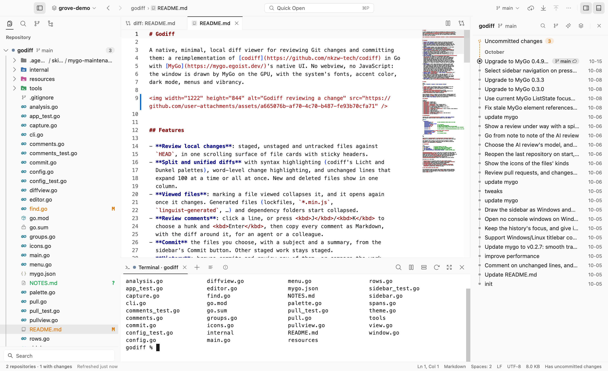
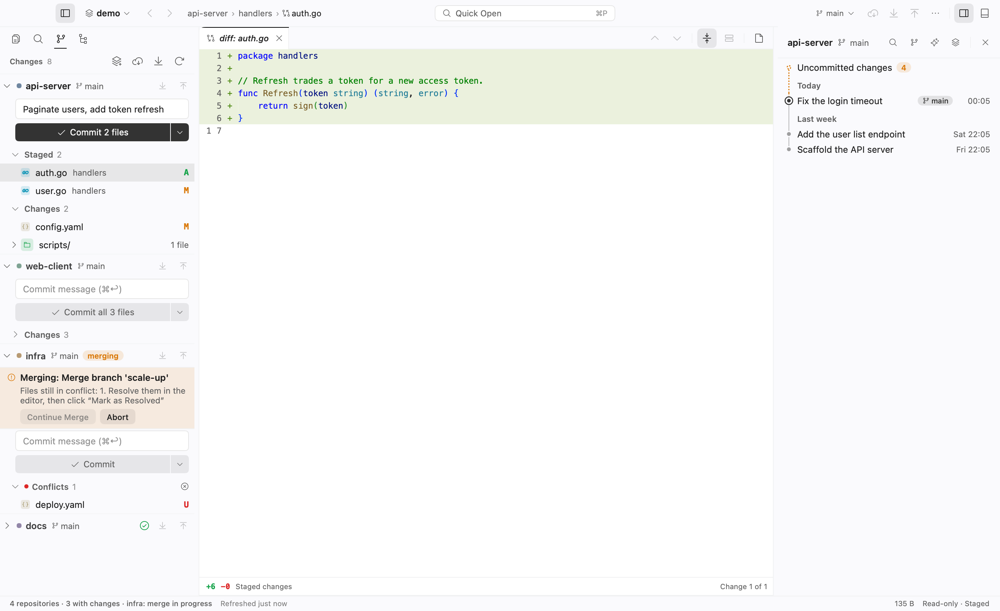
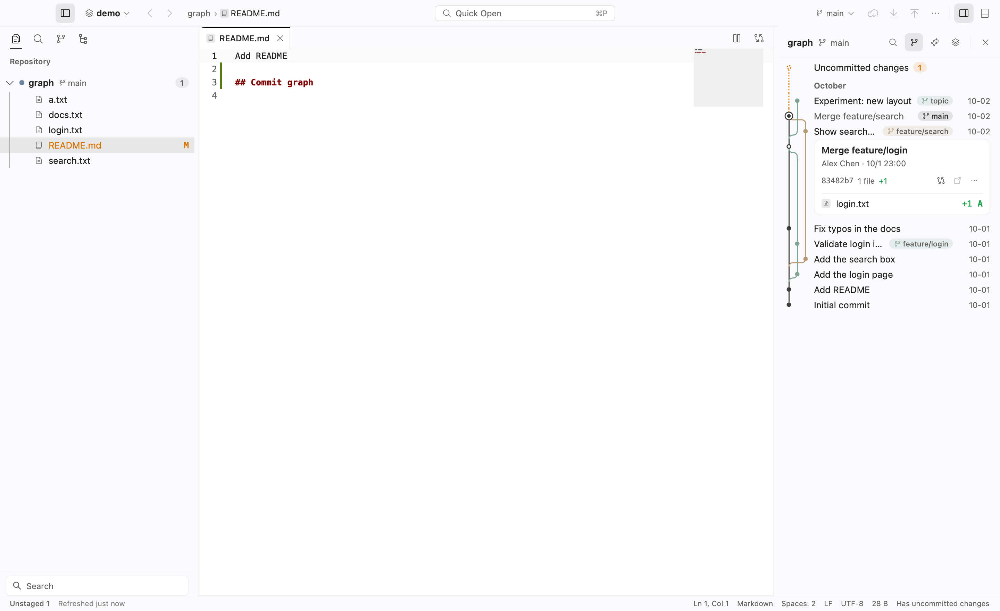
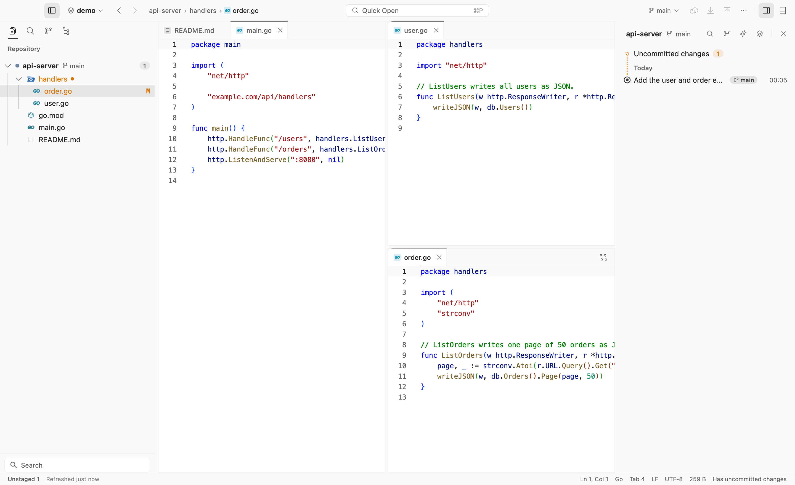
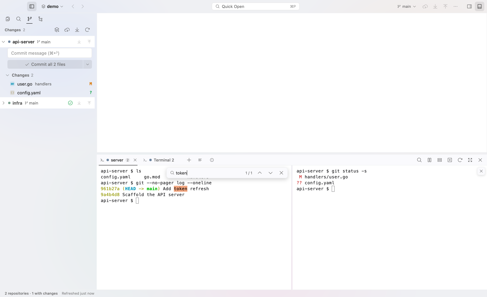
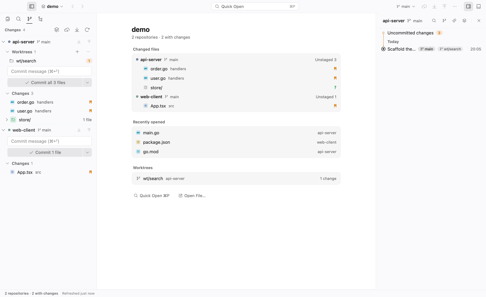
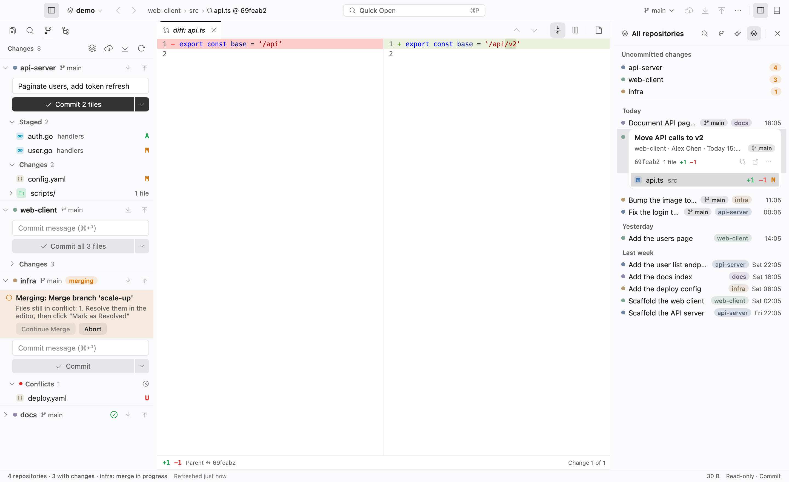

# Grove

English · [中文](README.zh-CN.md)

Grove is a multi-repo workbench for macOS. Browse files, edit code, review Git changes and commit history, and use
terminals in one window. The file tree and Git panel show every repo in your workspace, so you can review their
changes together.

Grove is written in Go, with a native UI drawn by [mygo](https://github.com/egoist/mygo). With five repos open, it uses
about 79 MiB of memory when idle.



## Three principles

- **Every repo visible at once**: the file tree and Git panel list all repos at the same time. Search, history and
  terminals are organized by repo too.
- **You decide when to make changes**: automatic refreshes only run read-only Git commands (with
  `GIT_OPTIONAL_LOCKS=0`, so the index is never touched). Staging, committing, pushing and other write operations only
  run when you trigger them, and operations that could lose data ask for confirmation first.
- **No automatic uploads**: Grove only connects to a remote when you start a Git operation such as fetch, pull, push
  or clone.

## Features

| | |
| --- | --- |
|  |  |
|  |  |
|  |  |

- **Workspace**: open a `.code-workspace` file or a folder, with support for multiple windows. Each repo gets a color,
  used in the file tree, the Git panel, terminal tabs and the merged history to show which repo something belongs to.
  With nothing open, the editor area shows a start page: changed files across all repos, recently opened files and
  other worktrees, which you can open with ↑↓ ⏎. Select and drag files across repos in the file tree, undo the last
  file operation, and press Space for a peek with the system Quick Look (images and PDFs included).
- **Editor**: drag a tab to an edge to split the editor. Includes an outline, sticky scroll, snippets and Markdown
  preview. The preview renders Mermaid diagrams and MathJax math (colored to match the theme, formulas drawn as
  vectors), front matter, the HTML READMEs commonly use and remote badges; HTML with `<style>` / `style=` is drawn with
  its grid, flex, backgrounds and borders like VS Code does. ⌥⇧⌘V opens a preview to the side: it and the editor
  scroll together, the block with the caret is marked, double-clicking jumps back to that source line, and it follows
  you to other Markdown tabs unless locked. Emoji shortcodes like :tada: work, and the 🔗 left of each heading copies
  its link.
  ⌘-click or F12 goes to a definition by name (searching every repo, with a list to pick from when there are several),
  resting the pointer on a name shows its declaration and comment, ⇧F12 finds references in every repo, and typing
  suggests words from the file, open files and the symbol index (⌃Space to ask).
  Encodings such as GB18030 and Big5 are supported. Click the language in the status bar to switch it; type in the
  menu to filter. On save, Grove can run formatters like gofmt and prettier and checks like go vet and eslint. A file
  replaced in the preview tab reopens where you left it.
- **Git**: stage by hunk or by line; edit an unstaged diff in place (the pencil on the tab strip; ⌘S writes the file
  back); the collapsed-lines bars say which function or section the changes below are in; ⌥Z soft-wraps a diff;
  resolve conflicts in the editor; and view a commit graph for one repo or the history of all repos merged by time.
  Merge, rebase (including interactive rebase), cherry-pick, stash, worktree and submodule operations are all
  available in the UI. Each repo's header in the Git panel has its own Pull and Push buttons and shows ahead / behind
  commit counts.
  In each repo the commit box sits at the top. Normally it is a single input line; the Commit button (a paper plane,
  whose tooltip says how many files it will commit) appears once you have typed a message. With nothing staged it
  commits all changes, untracked files included, and its ▾ holds Commit and Push, Amend last commit and Undo Last
  Commit. Change rows show the same file icon as the file tree, with M / A / D at the end of the row; when space runs
  out the path shrinks first. Untracked files share the "Changes" group with unstaged changes, and group buttons
  appear on hover. Worktrees and stashes are hidden by default: turn on "Show worktrees in the Git panel" / "Show
  stashes in the Git panel" under Settings → Git (Stash and Pop Stash work either way).
  With worktrees shown, each worktree is an agent's desk: one row in the Git panel with a single status mark (waiting
  for you, running, ready to merge, has changes, idle, merged). Expand it to see what it adds over the main branch,
  review it, or merge it into main. A collapsed worktree group shows the most urgent mark on the right of its header.
  The "Needs you" bar at the top of the sidebar lists worktrees across all repos that are waiting for you or ready to
  merge, and previous / next jump between them. The left of the status bar sums up every repo (how many have changes,
  how many need a push, which one is mid-merge); click it to open the Git panel.
  Git actions that are greyed out say why ("Push (in sync with origin)", "Remove Worktree (the main worktree can't be
  removed)"), and button tooltips show the git command they run.
  The commit history in the right panel shows one commit per line, grouped into Today / Yesterday / This week / Last
  week / This month / earlier months (the group header sticks to the top while scrolling). The selected commit expands
  into a card with the full title, author, time, branches, message body and changed files. Commits a coding agent
  (Claude, Codex, Copilot…) co-authored through Co-Authored-By show its name in the card, and you can filter to just
  those commits.
  Hovering (or selecting with the keyboard) a changed file shows Open File, Discard Changes and Stage / Unstage
  buttons; with the list focused, Space stages / unstages and ⌘⌫ discards, acting on all selected rows.
- **Terminals**: built on Ghostty's libghostty-vt. Each repo has its own set of terminals, with split panes. Layout
  and output are saved when you close the window. When an agent such as claude or codex runs in a terminal, its tab
  shows whether it is waiting for you (an amber dot: it rang the bell or sent a notification; gone once you switch in)
  or running (a spinner); more agent commands can be added in Settings.
- **Search and navigation**: search and replace across repos. ⌘P finds files, ⇧⌘P opens the Command Palette and ⌘T
  jumps to a symbol; ⇧⌘[ / ⇧⌘] switch to the previous / next tab, and ⌃Tab goes back to the last used tab.
- **Local history**: every save keeps a snapshot, so you can recover content you changed or deleted by mistake.
- **Other**: English and Chinese UI, light and dark themes, and customizable shortcuts. The UI is in English by
  default; choose Chinese under Settings → Language → Interface language (installs from before English became the
  default keep Chinese).

## Installing

Requires a Mac with Apple Silicon running macOS 13 or later. Run this in Terminal:

```bash
curl -fsSL https://github.com/lemoeade/grove/releases/latest/download/install.sh | sh
```

It downloads the latest version, verifies its signature, installs it in the Applications folder (or `~/Applications`
if you can't write there) and opens it. To uninstall:
`curl -fsSL https://github.com/lemoeade/grove/releases/latest/download/install.sh | sh -s -- --uninstall` (your settings
and data are kept).

You can also download the DMG from [Releases](https://github.com/lemoeade/grove/releases/latest) and drag Grove into
Applications. Grove isn't notarized by Apple yet, so macOS blocks it the first time you open it: go to System Settings →
Privacy & Security and click "Open Anyway" at the bottom of the page, or run
`xattr -dr com.apple.quarantine /Applications/Grove.app` in Terminal. You only need to do this once.

Once installed, Grove checks for updates once a day and, when a new version is out, shows what changed and lets you
decide whether to install it. Use Grove → Check for Updates… to check right away. Settings → Update turns automatic
checks off, or automatic download and install on.

## Building

You can also build Grove yourself:

```bash
git clone https://github.com/lemoeade/grove.git
cd grove
GOTOOLCHAIN=auto go tool mygo build -skip-dmg -skip-notarize -sign -
open build/darwin-arm64/Grove.app
```

mygo is declared in `go.mod` and doesn't need a separate installation. If your Go is older than required,
`GOTOOLCHAIN=auto` downloads the right version. See [docs/release.md](docs/release.md) for the release workflow,
auto-updates, signing and DMG packaging.

## Usage

Press ⌘O to open a folder or a `.code-workspace` file, or run `open -a Grove <path>` from the command line.
⌘1–9 jumps to the repo with that number, ⌘J shows or hides the terminal, and ⇧⌘J maximizes the bottom panel over the
editor area (press it again, or double-click the blank part of the panel's header, to restore).
See [docs/shortcuts.md](docs/shortcuts.md) for the full shortcut list.

Settings and sessions are saved in `~/Library/Application Support/Grove/`, logs in `~/Library/Logs/Grove/`.

## Known limitations

- No LSP: go to definition, hover, find references and completion all work by name (outline, symbol index and text
  search), without understanding types or scopes, so identically named symbols get mixed together.
- Only available for macOS on Apple Silicon. No plugin system.

## Development

```bash
GOTOOLCHAIN=auto go vet ./...
GOTOOLCHAIN=auto go test ./...
```

UI tests render in memory without opening a window; tests that write only use temporary repos. Read
[AGENTS.md](AGENTS.md) before changing code. Other documentation is in [docs/](docs/), and version changes are listed in
[CHANGELOG.md](CHANGELOG.md).

## Thanks

[mygo](https://github.com/egoist/mygo), egoist's [godiff](https://github.com/egoist/godiff) and
[kero](https://github.com/egoist/kero), libghostty-vt from [Ghostty](https://ghostty.org),
[JetBrains Mono](https://www.jetbrains.com/lp/mono/), [Mermaid](https://mermaid.js.org)
and [MathJax](https://www.mathjax.org). Other third-party components and their licenses are in
[resources/licenses/](resources/licenses/).

## License

[MIT](LICENSE)
