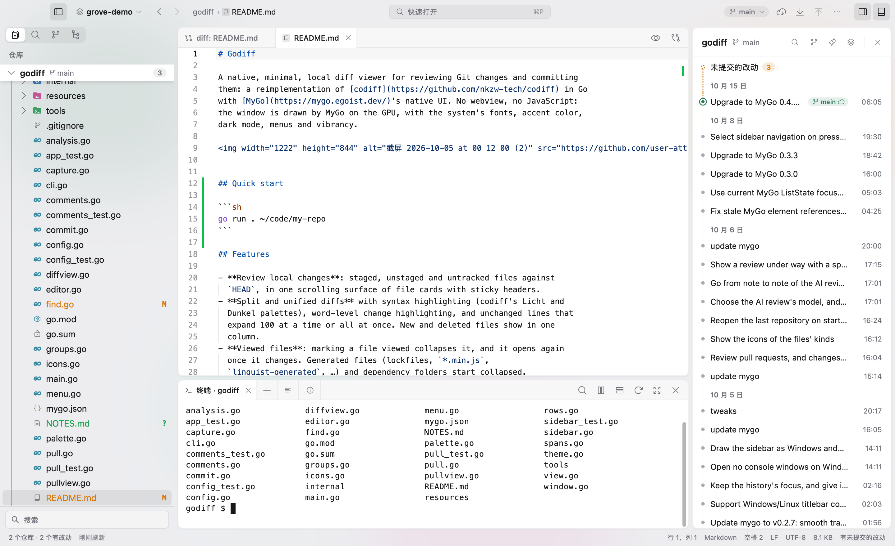
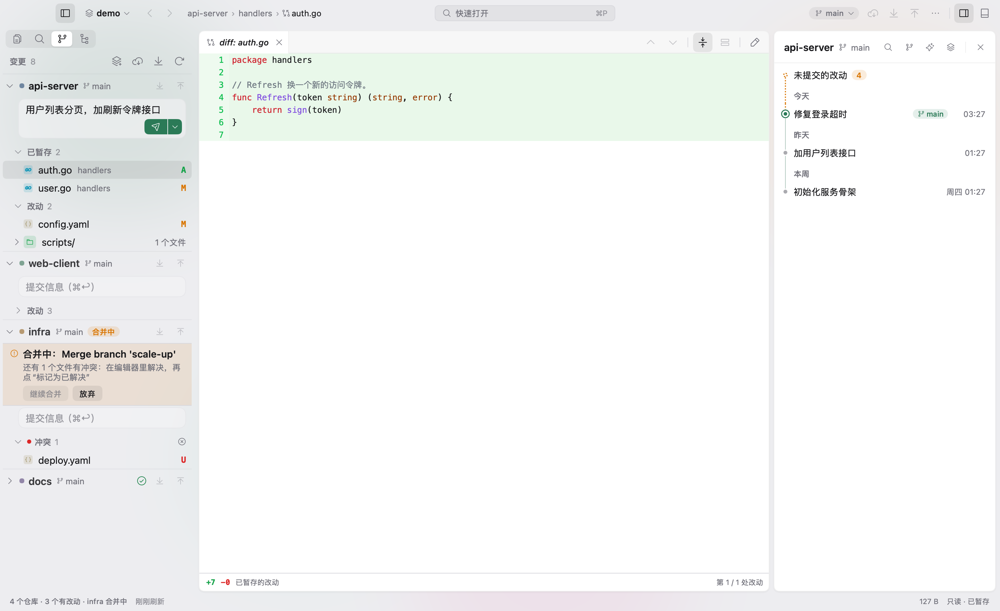
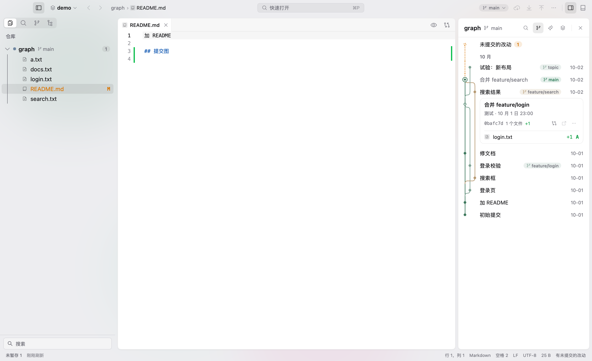
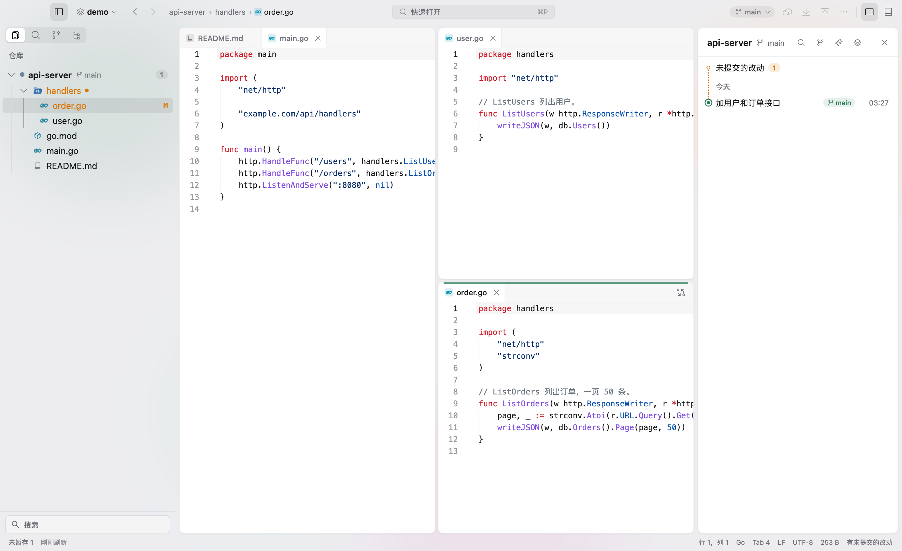
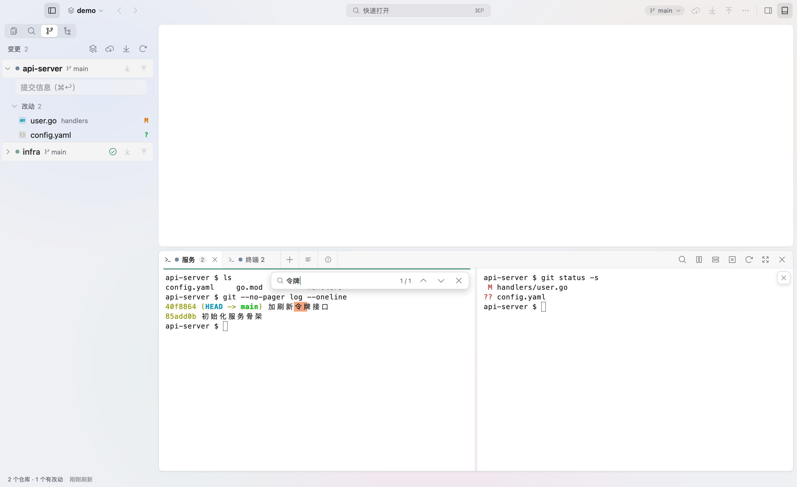

# Grove

中文 · [English](README.en.md)

Grove 是一个 macOS 多仓库工作台，可以在同一个窗口里浏览文件、编辑代码、查看 Git 改动和提交历史，以及使用终端。
工作区里的所有仓库都会显示在文件树和 Git 栏中，方便一起查看各个仓库的改动。

Grove 使用 Go 编写，界面由 [mygo](https://github.com/egoist/mygo) 原生绘制。打开五个仓库时，空闲内存占用约为 79 MiB。



## 三条原则

- **所有仓库同时可见**：文件树和 Git 栏同时列出所有仓库，搜索、历史和终端也按仓库组织。
- **由你决定何时修改**：自动刷新只执行只读的 Git 命令（设置 `GIT_OPTIONAL_LOCKS=0`，不修改索引）。暂存、提交、推送等操作
  都需要手动触发，可能造成数据丢失的操作会先要求确认。
- **不主动上传数据**：只有你发起抓取、拉取、推送或克隆等 Git 操作时，Grove 才会连接远程仓库。

## 功能

| | |
| --- | --- |
|  |  |
|  |  |

- **工作区**：支持打开 `.code-workspace` 文件或文件夹，也支持多窗口。文件树支持跨仓库多选和拖动，可以撤销上一次文件操作。
- **编辑器**：将标签拖到边缘即可分屏。支持大纲、粘性滚动、代码片段和 Markdown 预览（含 Mermaid 和公式），
  也支持 GB18030、Big5 等编码。保存时可运行 gofmt、prettier 等格式化工具，以及 go vet、eslint 等检查工具。
- **Git**：支持按块或按行暂存，在编辑器中解决冲突，以及查看单个仓库或多个仓库的提交图。合并、变基（含交互式变基）、
  cherry-pick、贮藏、工作树和子模块操作都可以在界面中完成。Git 栏每个仓库的段头上都有拉取和推送按钮，并显示领先 / 落后的提交数。
- **终端**：基于 Ghostty 的 libghostty-vt，每个仓库有一组终端，支持分屏。关闭窗口时会保存布局和输出。
- **搜索和导航**：支持跨仓库搜索和替换。⌘P 查找文件，⇧⌘P 打开命令面板，⌘T 跳转到符号；⇧⌘[ / ⇧⌘] 切上一个 / 下一个标签，⌃Tab 切回上一个用过的标签。
- **本地历史**：每次保存都会保留快照，方便找回误改或误删的内容。
- **其他**：支持中英文界面、浅色和深色主题，以及自定义快捷键。

## 构建

需要搭载 Apple Silicon 芯片、运行 macOS 13 或更新版本的 Mac。目前还没有安装包，需要自行构建：

```bash
git clone https://github.com/lemoeade/grove.git
cd grove
GOTOOLCHAIN=auto go tool mygo build -skip-dmg -skip-notarize -sign -
open build/darwin-arm64/Grove.app
```

mygo 已在 `go.mod` 中声明，无需单独安装。如果本机 Go 版本较旧，`GOTOOLCHAIN=auto` 会自动下载所需版本。
签名、公证和 DMG 打包说明见 [docs/release.md](docs/release.md)。

## 用法

按 ⌘O 打开文件夹或 `.code-workspace` 文件，也可以在命令行中运行 `open -a Grove <路径>`。
⌘1–9 跳转到对应序号的仓库，⌘J 显示或隐藏终端。
完整快捷键见 [docs/shortcuts.md](docs/shortcuts.md)。

设置和会话保存在 `~/Library/Application Support/Grove/`，日志保存在 `~/Library/Logs/Grove/`。

## 已知限制

- 没有 LSP，所以没有自动补全和跳转到定义。
- 只有 macOS（Apple Silicon）版本，没有自动更新，也没有插件系统。

## 开发

```bash
GOTOOLCHAIN=auto go vet ./...
GOTOOLCHAIN=auto go test ./...
```

界面测试在内存中渲染，不会打开窗口；涉及写操作的测试只使用临时仓库。修改代码前请先阅读 [AGENTS.md](AGENTS.md)。
其他文档见 [docs/](docs/)，版本改动见 [CHANGELOG.md](CHANGELOG.md)。

## 致谢

[mygo](https://github.com/egoist/mygo)，egoist 的 [godiff](https://github.com/egoist/godiff) 和
[kero](https://github.com/egoist/kero)，[Ghostty](https://ghostty.org) 的 libghostty-vt，
[JetBrains Mono](https://www.jetbrains.com/lp/mono/)，[Mermaid](https://mermaid.js.org)，[MathJax](https://www.mathjax.org)。
其他第三方组件和许可证见 [resources/licenses/](resources/licenses/)。

## 许可证

[MIT](LICENSE)
